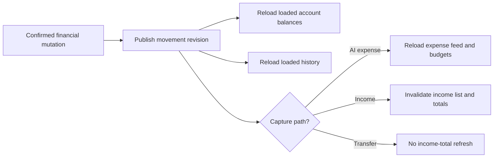

# Cross-Screen Synchronization Workflow

## Execution Plan

- [x] Inspect the isolated frontend baseline, user QA evidence, current AI-DLC state, and extension configuration.
- [x] Trace income writes through shared providers and verify the account projection from read-only backend source.
- [x] Audit expense, transfer, account, catalog, budget, text-capture, and receipt-capture mutation paths.
- [x] Record the requirements, root-cause evidence, scope, and verification limits.
- [x] Add a focused failing regression test for an already-rendered Accounts screen.
- [ ] Implement shared movement invalidation and queued refresh behavior at mutation boundaries.
- [ ] Add or update regression tests for mutation paths and refresh coalescing.
- [ ] Run focused tests and static analysis with the Dart/Flutter MCP server; format changed Dart files.
- [ ] Complete the cross-screen synchronization matrix and test report; update workflow state and audit log.

## Workflow Visualization

Text alternative: a confirmed mutation publishes one shared movement revision. Loaded Accounts and History providers reload. AI expense capture also refreshes the expense feed and budgets; income changes also invalidate the income list and dashboard totals; transfers do not invalidate income totals.

## Decisions

- User-visible stale data spans multiple screens and financial workflows, so one focused user story is included.
- Keep the backend and production environment read-only. The account endpoint remains the source of truth for balances.
- Keep the implementation in the existing Riverpod provider/controller boundaries; do not add a global state-management package or change navigation.
- Use the existing official Dart Tooling MCP server already registered in Codex; its tools are invoked through the SDK stdio server because this turn does not expose that server as a native tool namespace.
- The user's instruction “Continue without limitations / Flutter/Dart MCP tools install that then” authorizes continuing through implementation and verification. No open requirements question blocks this task.

## Extension Compliance

- Security Baseline: applicable to preserving authenticated repository calls, not changing API contracts, and avoiding sensitive data in diagnostics. No new storage, credentials, network endpoint, or authorization behavior is introduced.
- Resiliency Baseline: disabled in `aidlc-state.md`.
- Property-Based Testing: partial in `aidlc-state.md`; this regression is deterministic and no property test is required for the provider invalidation behavior.
