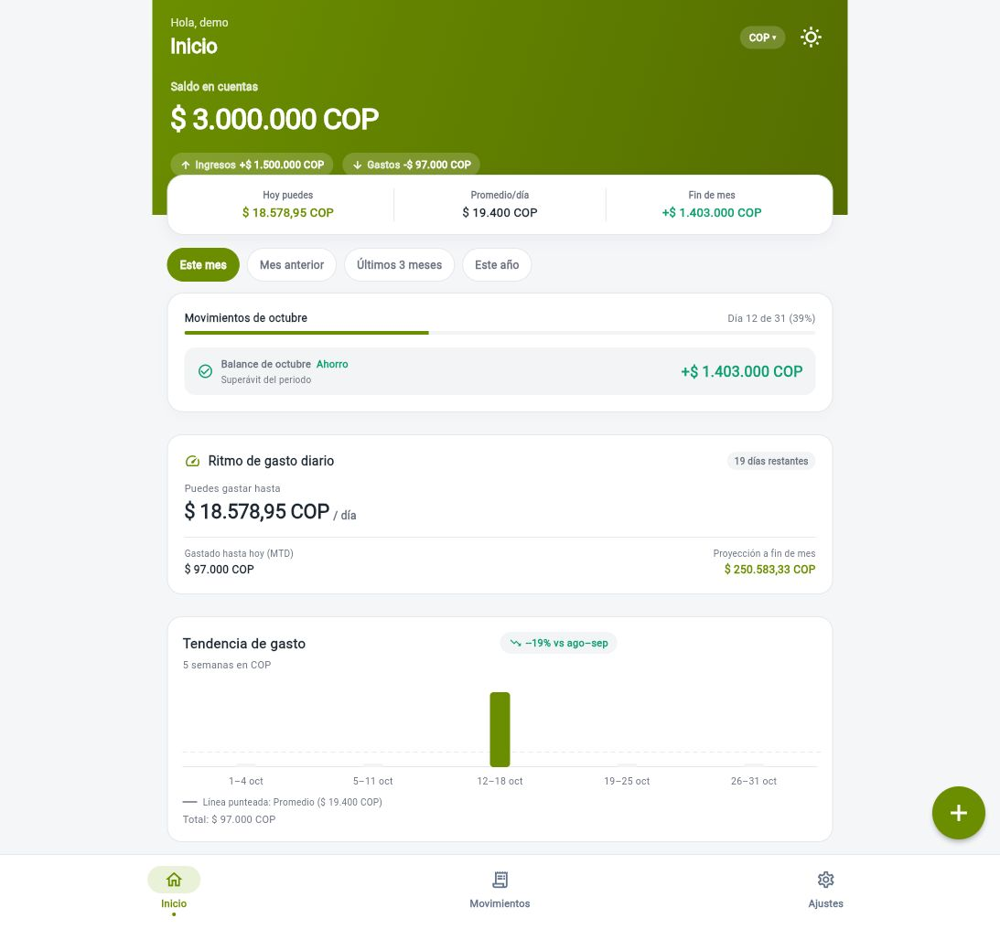
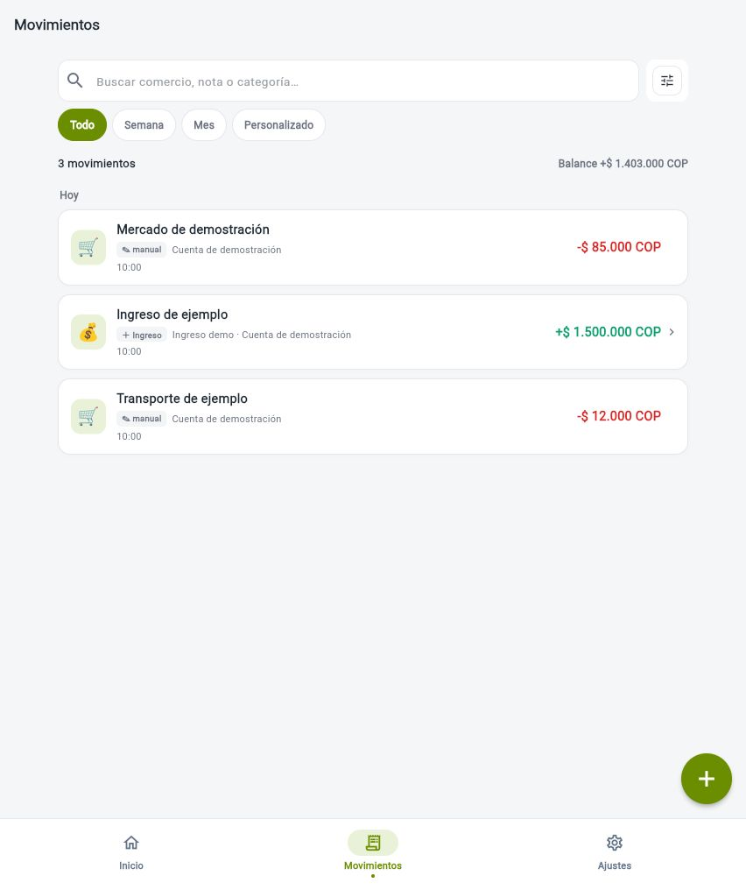
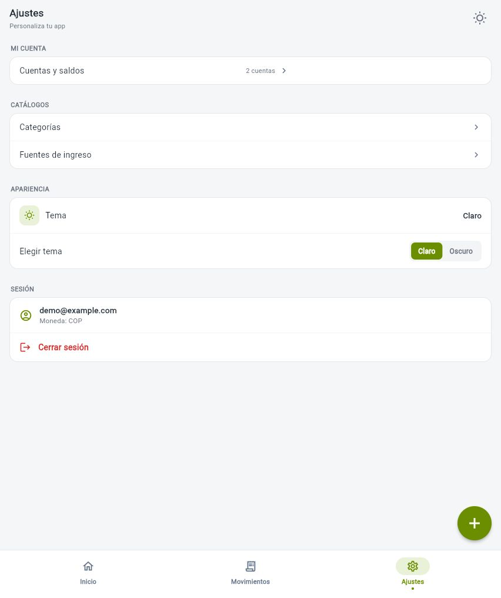
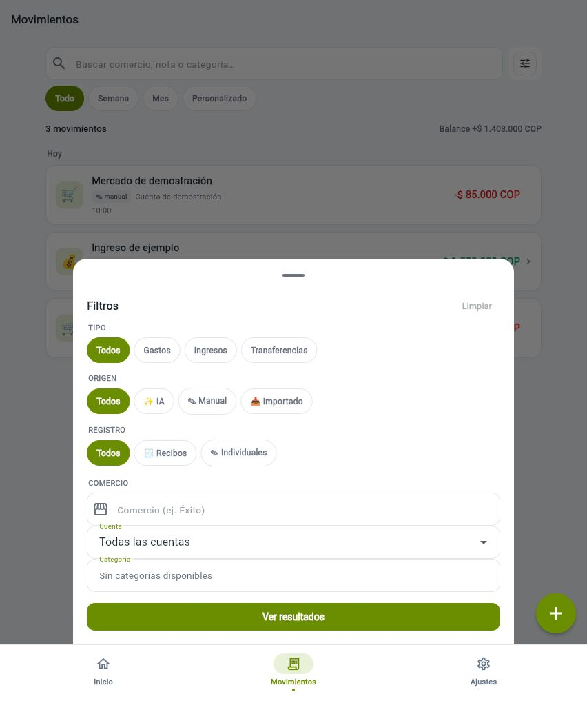
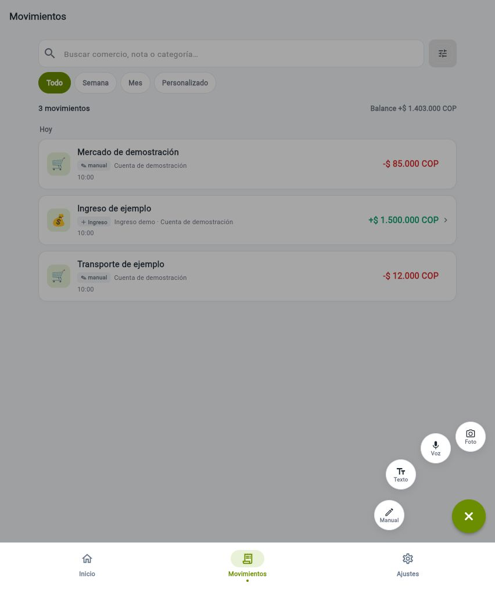

# Evidencia visual del rediseño Hero

Capturas de la UI Flutter de `feat/ui-hero-redesign`, tomadas el 12 de octubre de 2026 mediante Computer Use en el navegador integrado. Todos los nombres, movimientos, importes y la sesión `demo@example.com` son datos sintéticos.

## Qué cambió frente a develop

| Área | Antes | Ahora |
|---|---|---|
| Navegación | Gastos, Dashboard y Ajustes | Inicio, Movimientos y Ajustes; `/home` abre el resumen y `/dashboard` redirige a Inicio |
| Inicio | Dashboard con historial reciente y acceso a cuentas | Hero verde oliva con saldo, ingresos/gastos, indicadores y análisis; historial completo en Movimientos |
| Movimientos | Historial como ruta independiente y filtros en línea | Pestaña propia, búsqueda, periodos visibles y filtros avanzados en panel modal con contador |
| Captura | Rueda dentro del chat | Rueda global en todas las pestañas; texto/voz abren captura rápida en un panel |
| Ajustes | Pantalla de configuración | Conserva cuentas, catálogos, apariencia y sesión; participa en la nueva navegación y captura global |
| Atrás Android | Sin regla explícita en el shell | Desde Movimientos/Ajustes vuelve a Inicio; Inicio permite salir |
| Versión | 0.1.0+1 | 0.8.0+8 |

## Verificación

- `flutter analyze`: sin incidencias.
- `dart format --output=none --set-exit-if-changed lib test integration_test`: 196 archivos, cero cambios pendientes.
- `git diff --check`: limpio.
- `flutter test --coverage`: 442 pruebas aprobadas; cobertura 10.780 / 12.836 líneas (83,98 %).

## Alcance de las capturas

Se ejecutó una copia temporal de la app con las mismas pantallas y dependencias bloqueadas, un runner web de revisión y una API local de demostración. Para compilar JavaScript se adaptó únicamente en esa copia el límite máximo de enteros monetarios a `9007199254740991`; esa adaptación, el runner y el servidor de fixtures no forman parte del PR. Las capturas documentan la apariencia actual y no acreditan la ejecución nativa de cámara, dictado o Atrás de Android.

## Inicio — saldo, flujo del mes y tarjetas de análisis

## Movimientos — historial unificado y búsqueda

## Ajustes — cuentas, catálogos, tema y sesión

## Filtros — tipo, origen, registro, comercio y cuenta

## Captura global — foto, voz, texto y formulario manual

