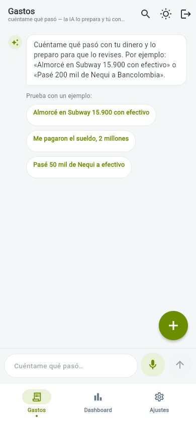
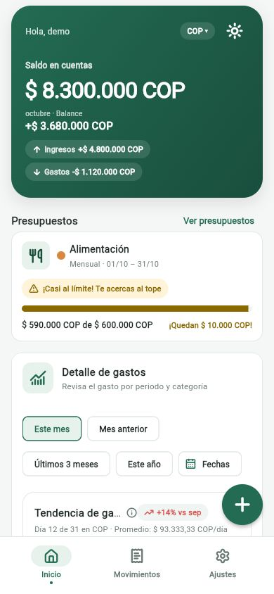
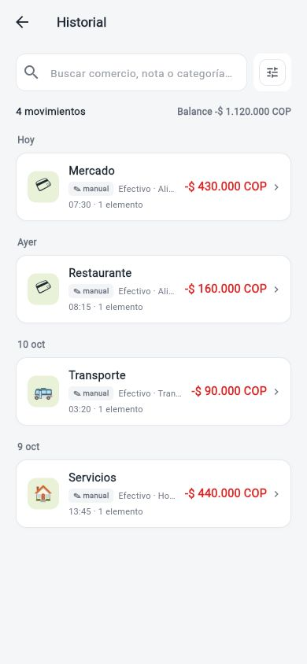
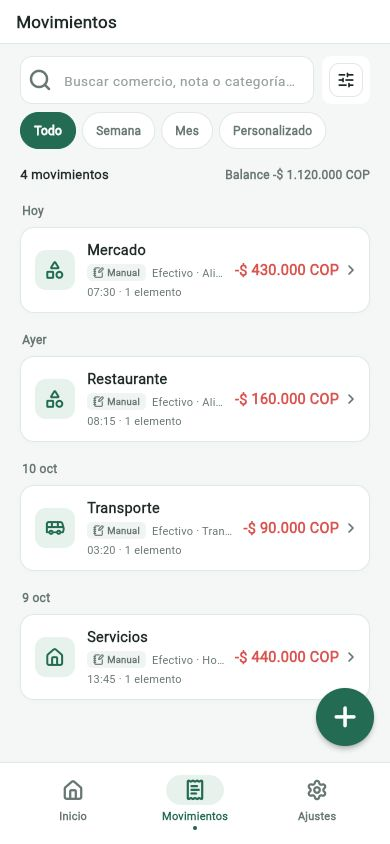
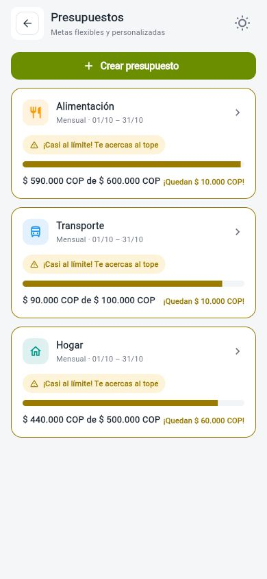
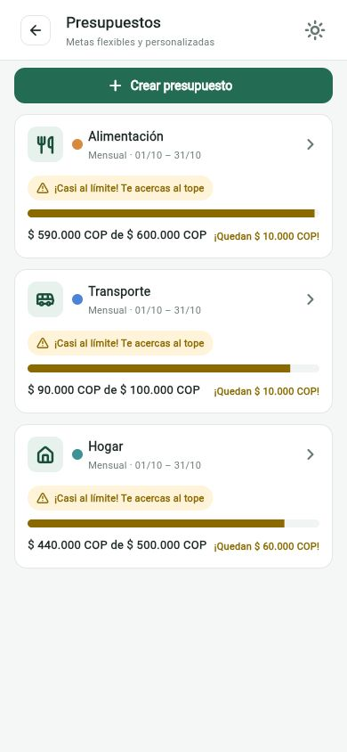

# Comparación móvil: `develop` y rama del PR

Las capturas se tomaron en el navegador web con el mismo viewport de celular: **390 × 844 px**. Todas usan una cuenta de demostración y datos sintéticos.

## Inicio

### Antes — `develop`

En `develop`, `/home` abre el flujo de Gastos y la captura por texto.

### Después — `codex/ui-consistency-mobile`

Inicio reúne el saldo de **$ 8.300.000 COP**, ingresos de **$ 4.800.000 COP**, gastos de **$ 1.120.000 COP** y una vista previa del presupuesto más cercano a su límite.

## Movimientos

### Antes — `develop`

El historial se abría desde el flujo de Gastos.

### Después — `codex/ui-consistency-mobile`

Movimientos tiene su propia pestaña con búsqueda, filtros por periodo, balance del listado y cuatro transacciones de ejemplo.

## Presupuestos

### Antes — `develop`

La pantalla muestra tres presupuestos mensuales con su progreso por categoría.

### Después — `codex/ui-consistency-mobile`

La lista mantiene los tres presupuestos de ejemplo y presenta sus estados próximos al límite con la interfaz unificada de la rama.

## Datos de demostración

- Saldo de la cuenta: **$ 8.300.000 COP**.
- Ingresos del mes: **$ 4.800.000 COP**.
- Gastos del mes: **$ 1.120.000 COP** en cuatro movimientos.
- Presupuestos: **Alimentación ($ 590.000 de $ 600.000)**, **Transporte ($ 90.000 de $ 100.000)** y **Hogar ($ 440.000 de $ 500.000)**.

Para preparar la captura base de `develop`, ajusté temporalmente el límite entero de moneda en una copia aislada porque la compilación web rechaza su valor original. Ese ajuste no forma parte de este PR.
